<div align="center">

# 💱 BNM Currency Converter

**Лабораторная работа 3 по PSI** · Dmitrii Anghis, группа TI-235 · УТМ, 2026

Desktop-конвертер валют по официальному курсу **Национального банка Молдовы**, сделанный по методике **Spec-Driven Development**: сначала спецификация, потом код.

[](https://github.com/DmitriiAnghis/currency-converter-sdd/actions/workflows/tests.yml)


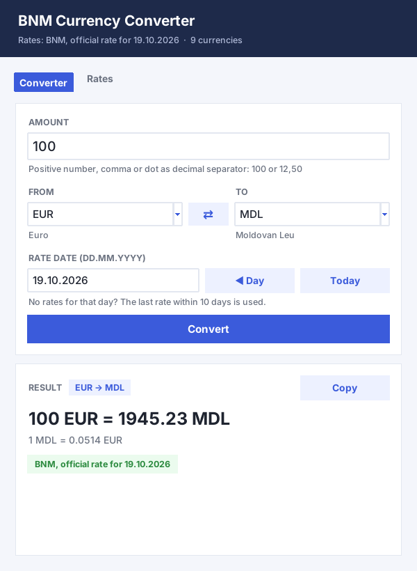

</div>

**Содержание:** [Возможности](#-возможности) · [Быстрый старт](#-быстрый-старт) · [Интерфейс](#-интерфейс) · [Как делалось (SDD)](#-как-делалось-spec-driven-development) · [Тесты](#-тесты) · [Структура](#-структура-проекта) · [Git](#-работа-с-git) · [Уведомления](#-уведомления-о-коммитах-на-почту)

---

## ✨ Возможности

- **Официальный курс BNM**: курсы берутся из XML на `bnm.md`, поддерживаются MDL и все валюты BNM, с учётом номинала (10, 100 единиц).
- **Точная арифметика**: `decimal.Decimal`, результат округляется до двух знаков (half-up), показывается и обратный курс.
- **Кросс-курсы**: любая пара валют, например USD → EUR, считается через MDL.
- **Дата курса**: если на выбранный день курса нет (выходной, праздник, будущая дата), берётся последний курс за 10 дней, и программа прямо пишет, за какую дату он.
- **Работа без сети**: последний удачный ответ сохраняется в кэш (`%APPDATA%` на Windows). Если BNM недоступен, программа предлагает посчитать по сохранённому курсу и помечает результат как `cache from …`.
- **Проверка ввода**: запятая или точка, отказ на пустое, ноль, минус, буквы и смешанные разделители.
- **Окно не зависает**: запрос к BNM идёт в фоновом потоке.

## 🚀 Быстрый старт

Нужен Python 3.12 или новее.

```bash
git clone https://github.com/DmitriiAnghis/currency-converter-sdd
cd currency-converter-sdd
python -m pip install -e ".[test]"
python -m converter      # запуск
python -m pytest         # тесты
```

## 🪟 Интерфейс

Всё в **одном окне с вкладками**, без всплывающих окон:

| Вкладка | Что делает |
|---|---|
| **Converter** | Сумма, валюты «откуда» и «куда» (под ними полное название), кнопка **⇄** меняет их местами. Дата курса, кнопки **◀ Day** (день назад) и **Today**. **Convert** или **Enter** считает, **Esc** очищает результат. Результат в карточке: сумма, обратный курс, источник (зелёная плашка BNM или оранжевая «cache»), предупреждение, если взят курс за другой день. **Copy** копирует результат. |
| **Rates** | Таблица всех курсов BNM на дату: код, название, номинал, курс в MDL и за 1 единицу. **Поиск** по коду и названию, **Load for date** загружает курсы на дату из формы. Двойной щелчок по строке открывает конвертер с этой валютой. |

- В тёмной шапке видно, какие курсы сейчас загружены: источник, дата и число валют.
- Ошибки ввода показываются красным прямо под формой.
- Если BNM недоступен, под шапкой появляется оранжевая полоса с кнопками **Use saved rates** и **Decline**.

<table>
<tr>
<td width="50%"><b>Пустое окно</b><br>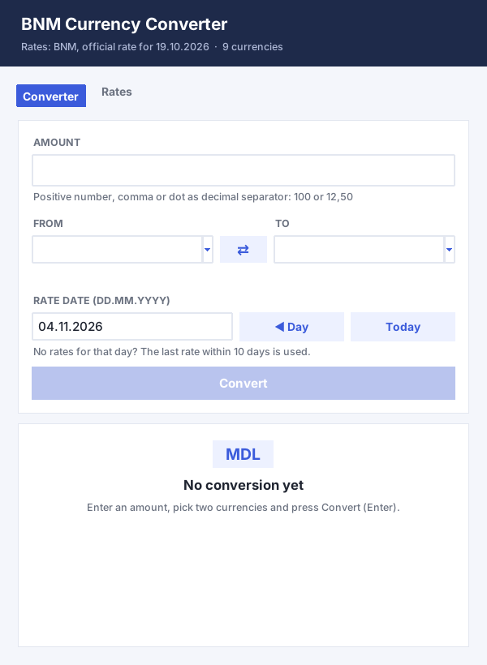</td>
<td width="50%"><b>Кросс-курс USD → EUR</b><br>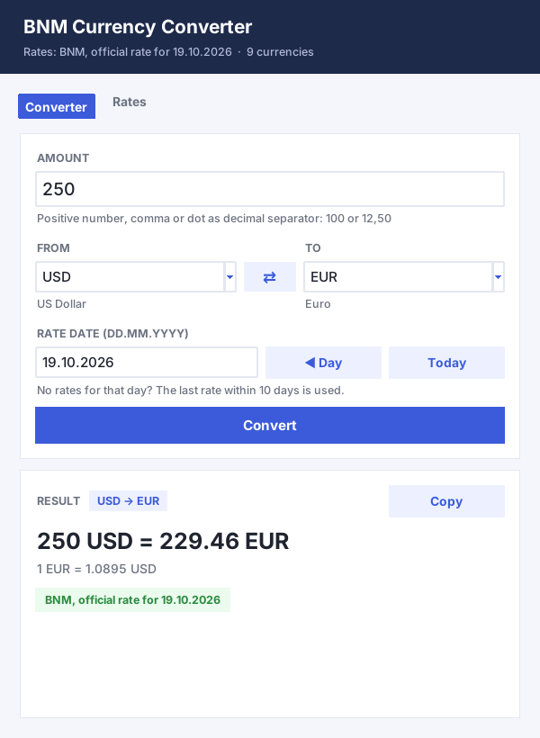</td>
</tr>
<tr>
<td><b>Выходной: взят курс за другой день</b><br>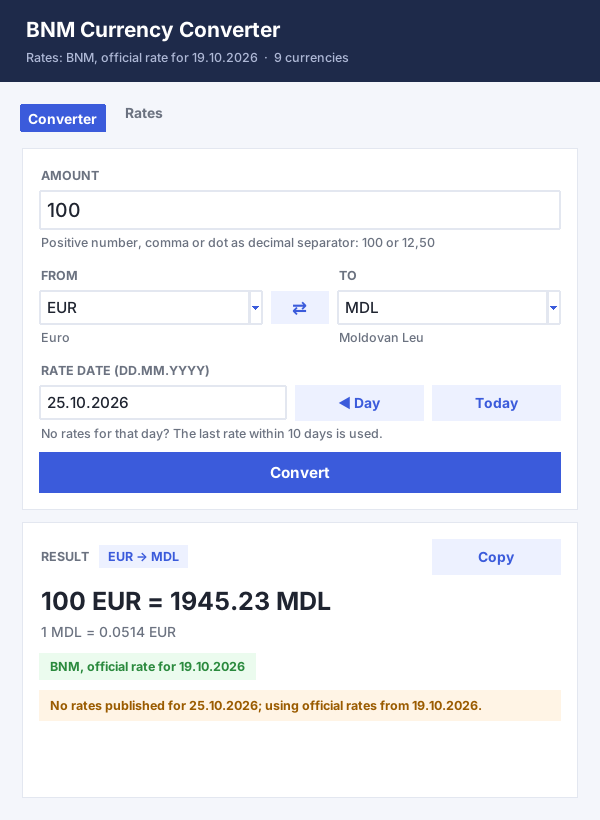</td>
<td><b>Ошибка ввода под формой</b><br>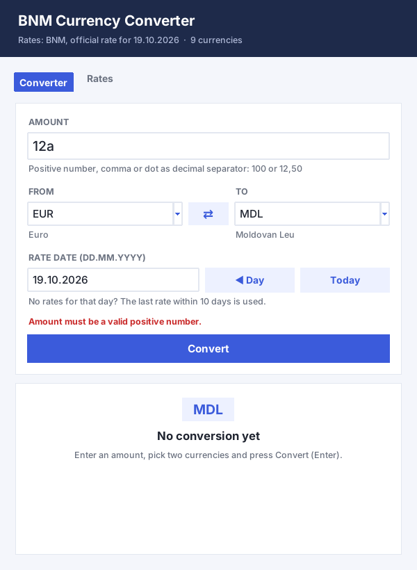</td>
</tr>
<tr>
<td><b>Нет сети: предложение взять сохранённый курс</b><br>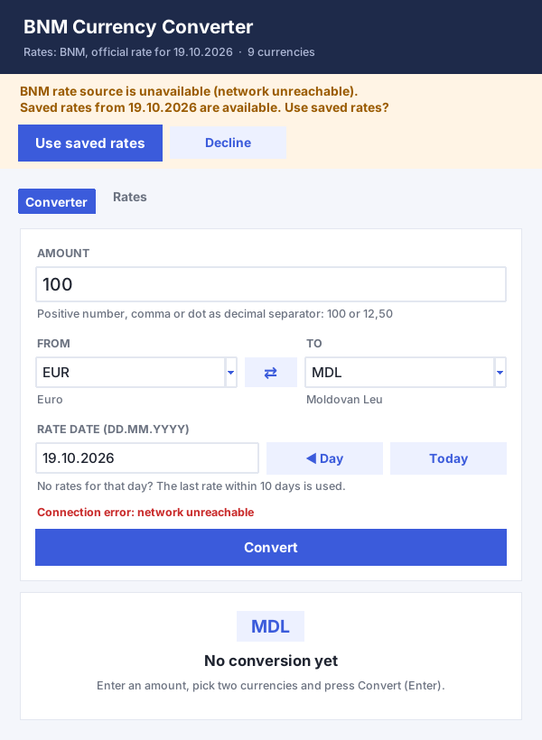</td>
<td><b>Результат по сохранённому курсу</b><br>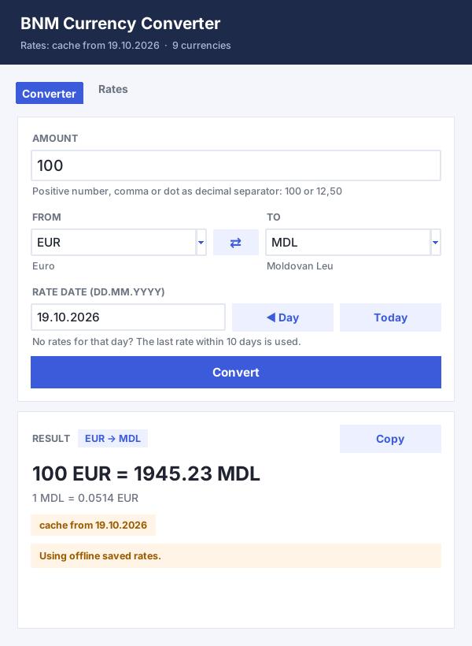</td>
</tr>
<tr>
<td><b>Вкладка Rates: все курсы на дату</b><br>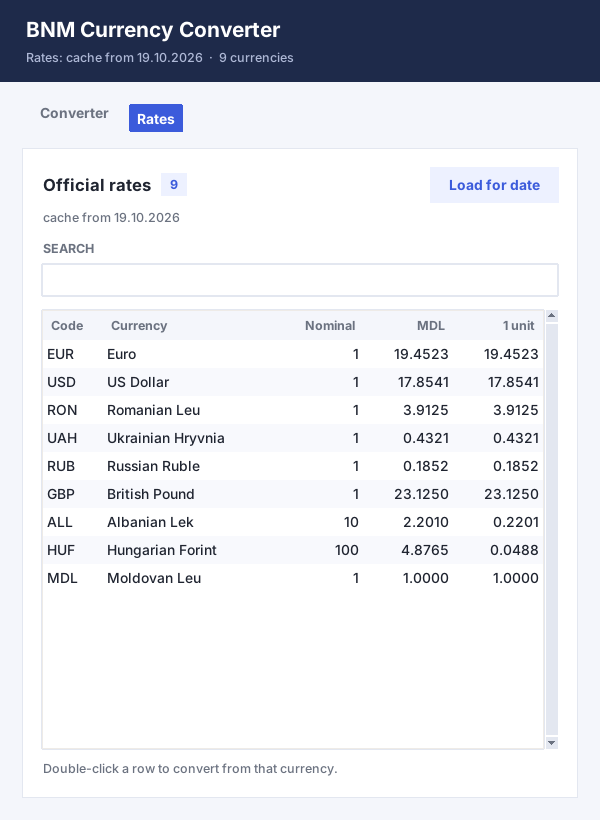</td>
<td><b>Поиск по курсам</b><br>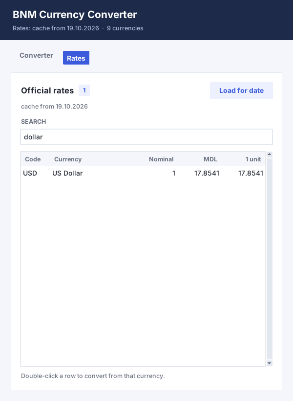</td>
</tr>
</table>

<details>
<summary>🕰️ Как окно выглядело до редизайна</summary>

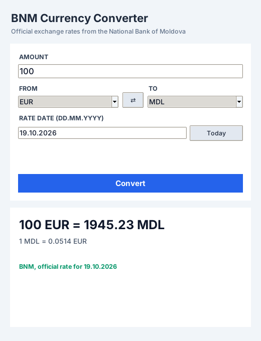

</details>

## 🧭 Как делалось: Spec-Driven Development

| Этап | Кто делал | Результат | Ветка |
|---|---|---|---|
| `/speckit-constitution`, `/speckit-specify`, `/speckit-plan`, `/speckit-tasks`, `/speckit-analyze` | **Spec Kit + GitHub Copilot** | [`constitution.md`](.specify/memory/constitution.md), [`spec.md`](specs/001-bnm-currency-converter/spec.md), [`plan.md`](specs/001-bnm-currency-converter/plan.md), [`tasks.md`](specs/001-bnm-currency-converter/tasks.md), [контракты](specs/001-bnm-currency-converter/contracts/) | `spec` |
| `/speckit-implement`: все 27 задач из `tasks.md` | **Google Antigravity** | код в `src/converter/` | `implementation` |
| Тесты на граничные случаи из `spec.md` | вручную (фильтр Gemini остановил агента) | `tests/test_edge_cases.py` и др. | `tests` |
| Отчёт | | [`REPORT.md`](REPORT.md) | `docs/report` |
| Новый дизайн окна, README, CI | | вкладки, полосы вместо окон, 19 новых тестов | этот PR |

<details>
<summary>🤖 Скриншоты этапов Spec Kit и Antigravity</summary>

| Constitution | Specify |
|---|---|
| 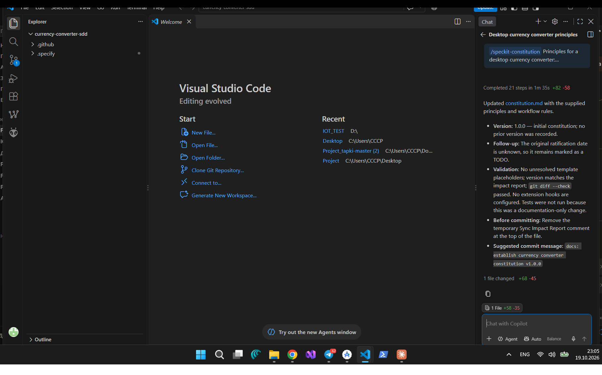 | 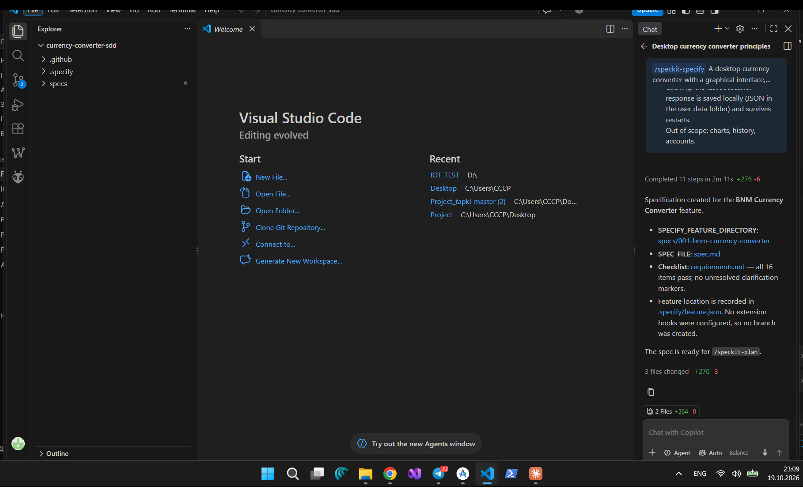 |
| **Plan** | **Tasks** |
| 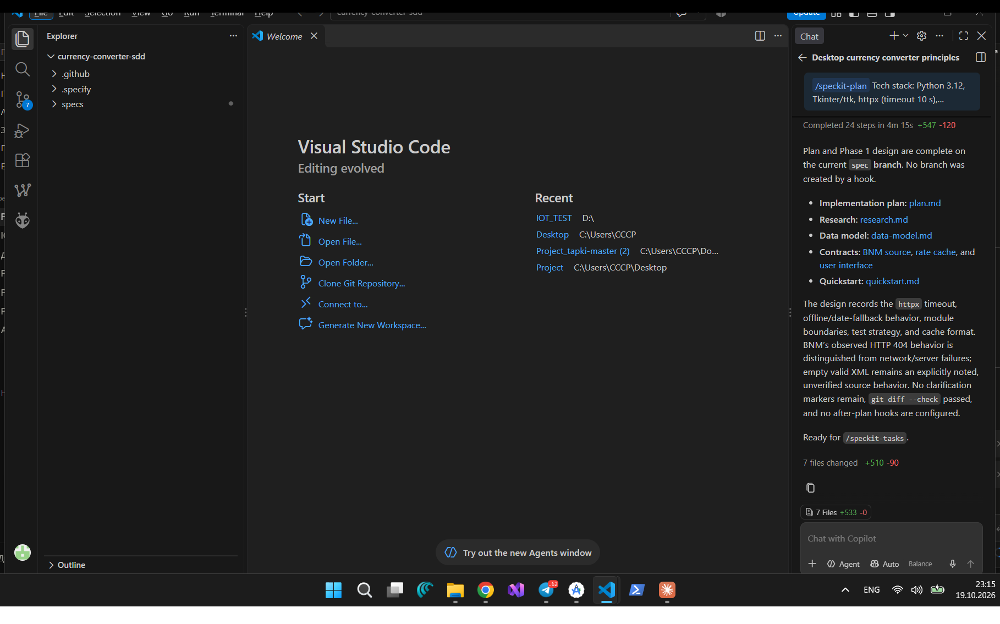 | 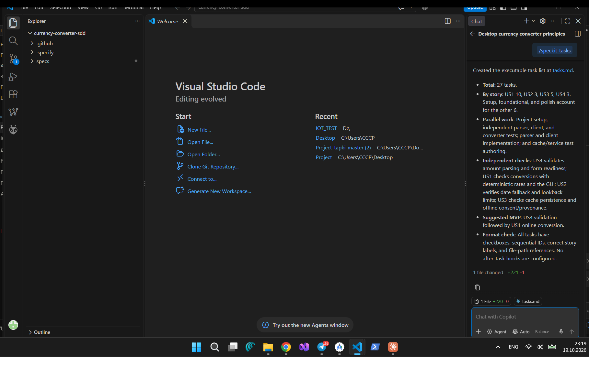 |
| **Analyze** | **Antigravity: старт** |
| 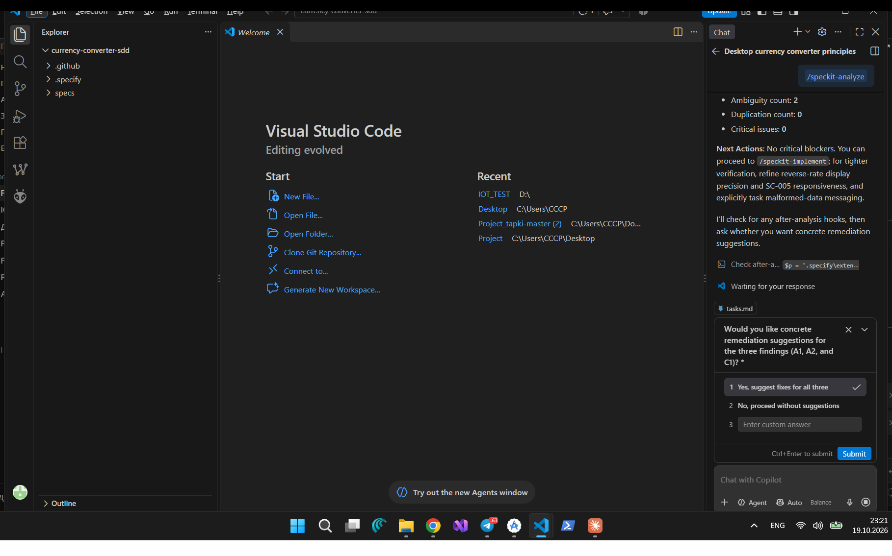 | 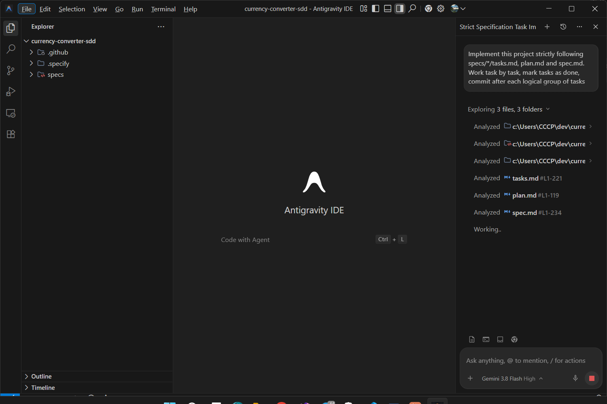 |
| **Antigravity: 27/27 задач** | **Фильтр Gemini на этапе тестов** |
| 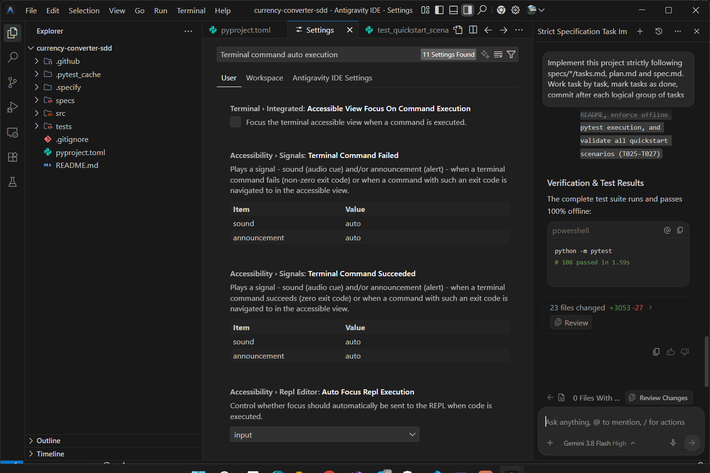 | 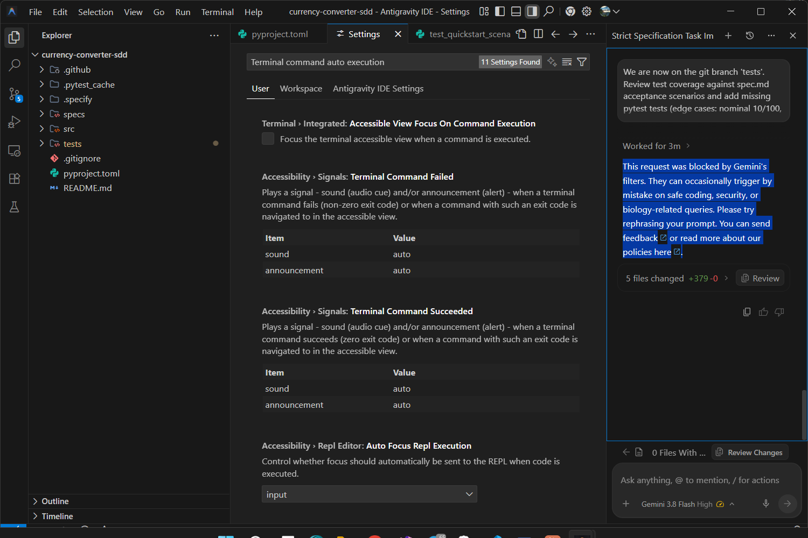 |

</details>

## 🧪 Тесты

Тесты не ходят в интернет: сеть в них заблокирована фикстурой, курсы берутся из [`tests/fixtures/bnm_rates.xml`](tests/fixtures/bnm_rates.xml). GitHub Actions запускает их при каждом push на **Windows и Linux**, Python 3.12 и 3.13 (вкладка **Actions**).

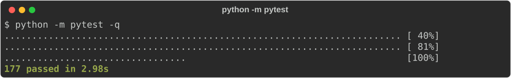

## 📁 Структура проекта

```text
src/converter/
├── __main__.py         запуск: python -m converter
├── bnm_client.py       HTTP-клиент BNM (таймаут 10 с, разбор ошибок)
├── parser.py           разбор XML с курсами
├── converter.py        арифметика на Decimal, кросс-курсы, номиналы
├── rates_service.py    поиск курса на 10 дней назад, работа с кэшем
├── cache.py            JSON-кэш в папке пользователя
├── validation.py       проверка суммы
└── gui.py              окно Tkinter: вкладки Converter и Rates
tests/                  145 тестов pytest
specs/001-bnm-currency-converter/   спецификация, план, задачи, контракты (Spec Kit)
.specify/               конституция и шаблоны Spec Kit
.github/workflows/      тесты и письмо о новых коммитах
docs/screenshots/       скриншоты для README
```

## 🌿 Работа с Git

- Каждый этап SDD сделан в своей ветке: `spec` → `implementation` → `tests` → `docs/report`, и попал в `main` через Pull Request.
- История видна во вкладке **Pull requests → Closed**.

## 📬 Уведомления о коммитах на почту

Workflow [`.github/workflows/notify-push.yml`](.github/workflows/notify-push.yml) при каждом push присылает письмо со списком новых коммитов. Пока секреты не заданы, он ничего не делает. Чтобы включить: **Settings → Secrets and variables → Actions → New repository secret**, и добавить:

| Секрет | Значение |
|---|---|
| `MAIL_USERNAME` | адрес отправителя, например Gmail-адрес |
| `MAIL_PASSWORD` | пароль приложения (Gmail: Google Account → Security → App passwords) |
| `MAIL_TO` | куда слать письма |

По умолчанию используется SMTP Gmail (`smtp.gmail.com:465`). Для другой почты добавь секреты `MAIL_SERVER` и `MAIL_PORT`.
